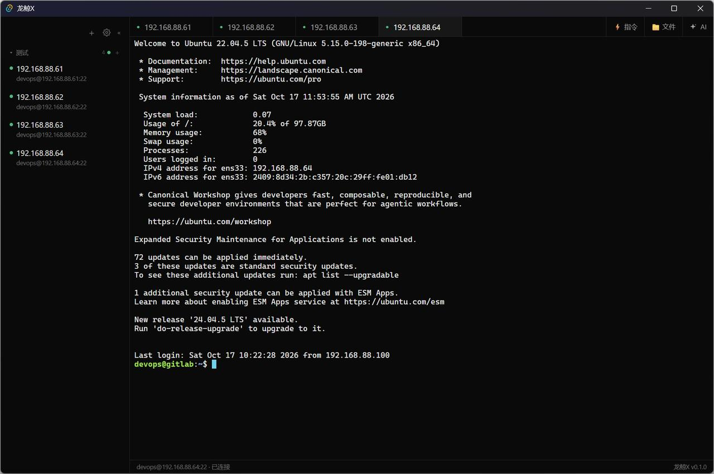
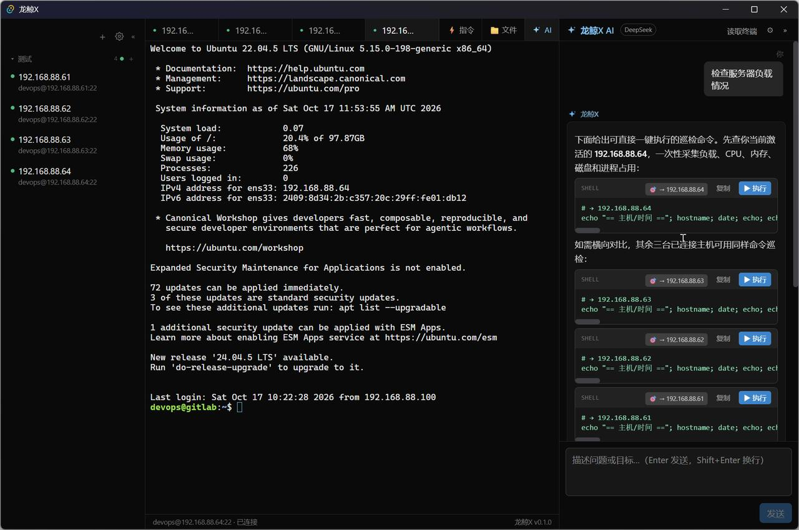
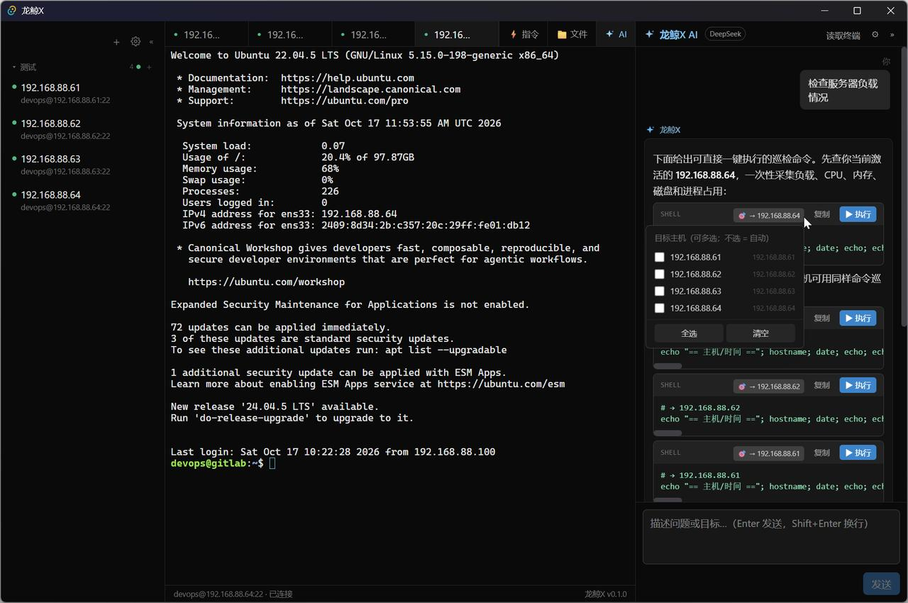
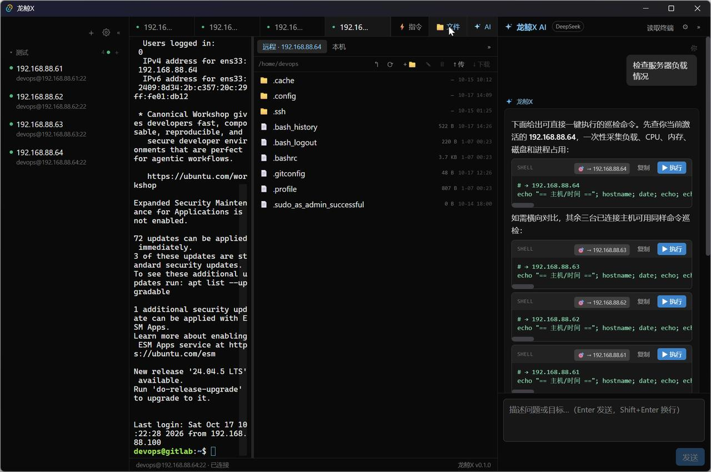
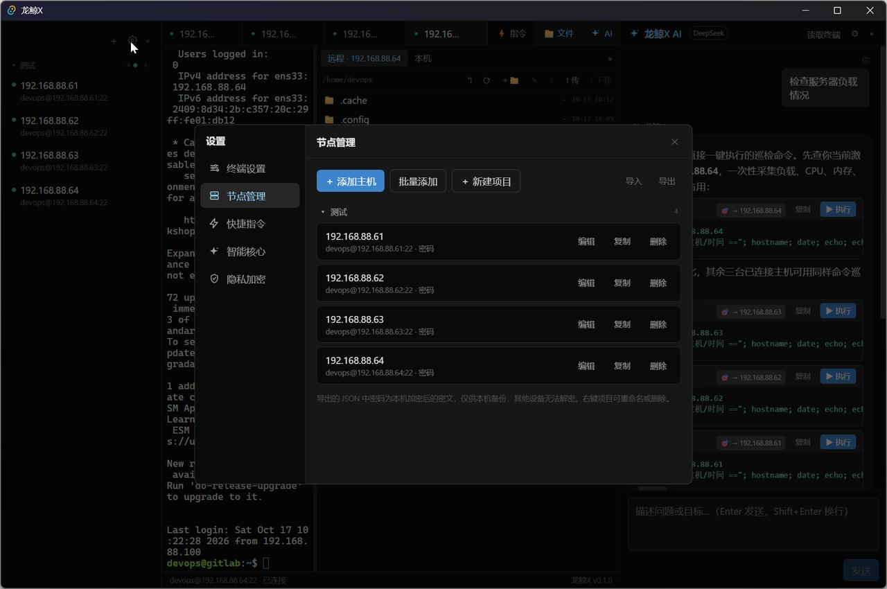
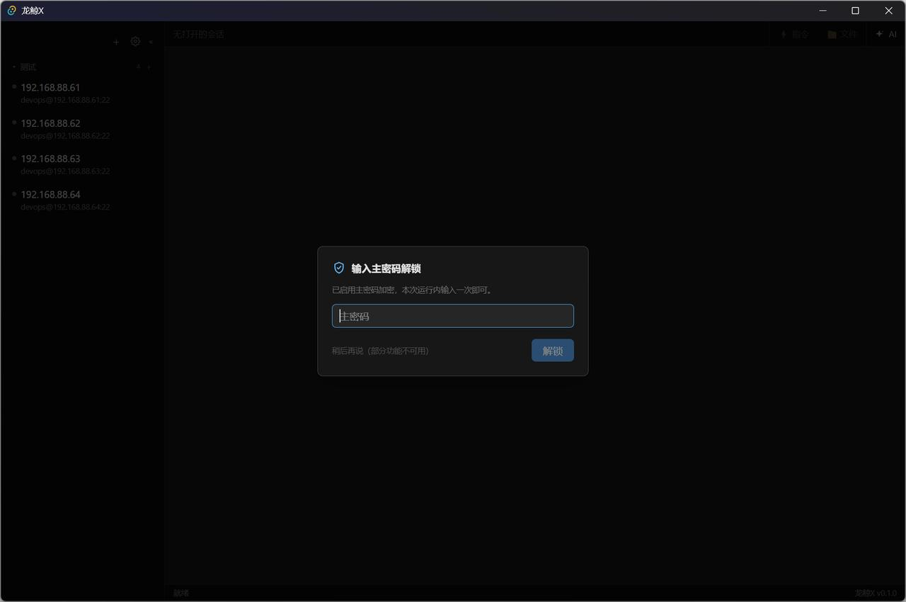
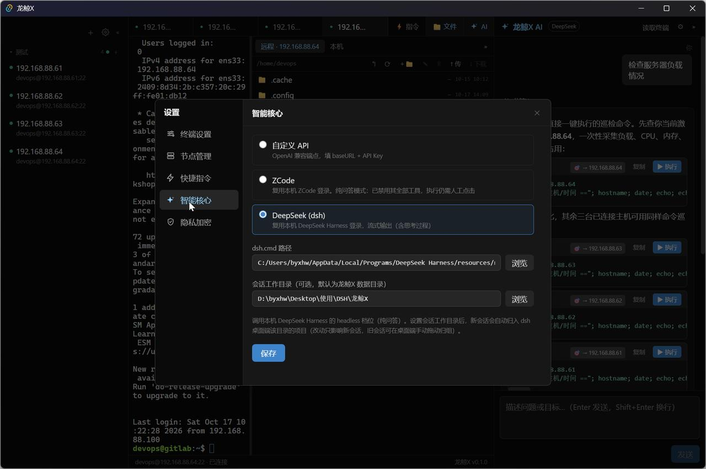

#  龙鲸X（LongjingX）

> 自用 SSH 运维工作台 + AI 助手：多标签终端、多主机 AI 协同、SFTP 文件管理，装进一个绿色可执行文件。

## 📸 界面预览

**多标签终端 + 主机工作台**：四台测试机同时在线，主机按项目分组、连接状态一目了然。



**AI 多主机协同**：一句话生成多台主机的巡检命令，每条命令标注目标主机、一键执行。



## ✨ 功能特性

### 🖥 多标签 SSH 终端

- 密码 / 私钥（ed25519、RSA）双认证，首次连接 **TOFU 指纹确认**防中间人
- 终端**常驻不卸载**：切换标签不丢画面、不断会话
- **复制会话**：右键标签一键同主机多开，排查现场并存多会话
- 标签栏可横向滚动、切换时自动滚入视野，终端开再多也不会点到无法关闭
- **PuTTY 风格快捷粘贴**（选中即复制 / 右键粘贴，可关闭），命令块附一键复制按钮
- 断线自动检测、一键重连；终端外观可调（字号、光标闪烁、回滚行数）即时生效
- 全局屏蔽 WebView 默认右键菜单与 F5 / Ctrl+R 刷新——**误触不会重载页面丢掉全部会话**

### 🤖 AI 助手「龙鲸X」（多主机协同）

**三种后端任选，后两种免配置 Key：**

| 后端 | 说明 |
|---|---|
| 自定义 API | 任意 OpenAI 兼容端点（GLM、DeepSeek、自建网关…），支持获取模型列表 |
| ZCode | 复用本机 ZCode 桌面版登录，保留原生代理能力（可在设置中调权限模式） |
| DeepSeek (dsh) | 复用本机 DeepSeek Harness 登录，流式输出 + 思考过程展示 |

**多主机命令路由**（下图）：AI 生成的命令自动标注目标主机（`# → 主机名`），
每条命令渲染为独立卡片——点「▶ 执行」发往对应会话，「复制」取走命令文本。



- **手动多选**：点 🎯 展开已连接主机清单，勾选任意组合（全选即广播，广播执行有红色确认框）
- **读取终端**：勾选多台会话，把最近输出分别喂给 AI，回答逐台标注来源
- **环境感知**：已连接主机清单自动注入上下文，AI 不会答非所问
- 回答走 **GFM 渲染**（表格 / 列表 / 代码高亮），建议命令与解释文本分离
- **安全模型不变**：AI 只出建议，**执行必须人工点击**；取消即强杀后端进程
- dsh 会话自动归组到 Harness 桌面端对应目录的项目，历史会话两边都能续

### 📂 SFTP 文件面板



- 本机 ↔ 远程双栏浏览，终端常驻不卸载，面板宽度可拖
- 上传 / 下载实时进度、中途取消（自动清理半成品文件）
- 远端文本在线编辑（CodeMirror），保存回写
- 右键菜单：重命名 / 删除 / 新建目录等常用操作

### 🗂 主机与项目管理



- 项目分组增删改、可折叠；主机条目悬停即得 **复制 / 编辑 / 删除** 快捷操作
- **测试连接**：保存前验证凭据（8 秒超时，显示耗时或失败原因）
- 批量添加、JSON 导入 / 导出，迁移备份方便
- 快捷指令库：常用命令一键发送到当前会话

### 🔒 安全中心



- 默认**系统级加密**（Windows DPAPI / 凭据管理器保护密钥），零使用成本
- 可选主密码：**AES-256-GCM + PBKDF2（SHA256，31 万轮）**，每次启动解锁一次
- 闲置自动锁定 + `Ctrl+Alt+L` 手动锁定；锁定时敏感字段不出应用

### 🎛 设置



多页设置（终端外观 / 节点管理 / 快捷指令 / 智能核心 / 隐私加密），打开时才加载最新配置，所见即所存。

## 🔧 技术栈

Tauri 2 · Rust（russh、ring）· React 19 · TypeScript · xterm.js 6 · Tailwind CSS 4

## 🚀 快速开始

环境要求：Node.js 18+、pnpm、Rust toolchain（MSVC）、WebView2（Windows 10/11 自带）

```bash
pnpm install
pnpm tauri dev     # 开发模式
pnpm tauri build   # 打包（绿色 exe + NSIS 安装包 + MSI）
```

## 📦 AI 后端接入说明

| 后端 | 说明 |
|---|---|
| 自定义 API | 填 Base URL + API Key + 模型名，支持「获取模型列表」 |
| ZCode | 留空路径自动探测（`*/ZCode/resources/glm/zcode.cjs`） |
| DeepSeek | 留空路径自动探测（`%LOCALAPPDATA%\Programs\DeepSeek Harness\...`） |

接入 ZCode / dsh 时复用桌面应用登录态，会话历史保存在对应应用内，可在其官方界面续接；
dsh 会话按「会话工作目录」自动归入其桌面端的项目分组。

## ⚠️ 安全说明

- 主机密码与 API Key 存储于本机 SQLite（`data\longjing.db`），**不上传任何服务器**
- 已启用系统级 / 主密码加密，但请自行评估本机磁盘安全
- 「导出主机」功能生成**含明文密码**的 JSON，仅用于本机迁移，请妥善保管
- AI 后端为 ZCode 时，其代理能力作用于**本机**（非 SSH 远程服务器），可在设置中调整权限模式

## 📄 许可

[GPL-3.0](LICENSE)
